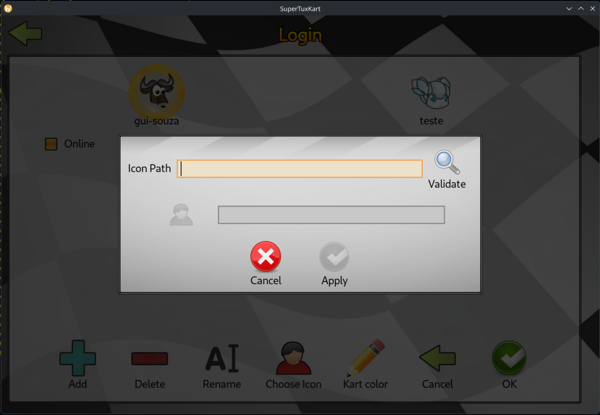
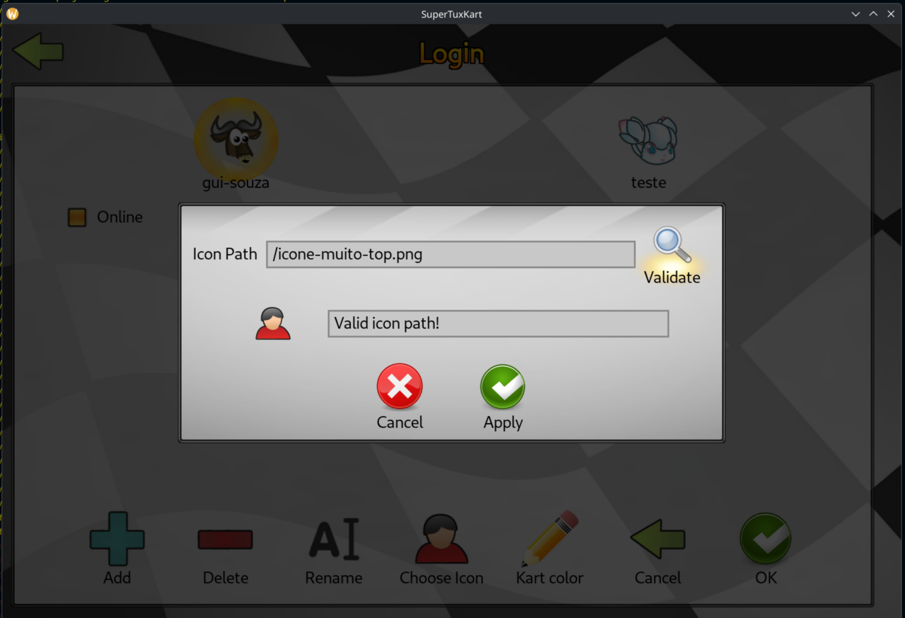

# Semana 11

## 5/11 e 6/11

- Criei um novo dialog
- Ao abrir o dialog em cima de outro, o anterior é fechado

- Passos pro novo dialog:
    - Caixa de input de texto
    - Botão de check para o path
        - se Ok, m_valid_icon_path = true
    - Aplicar novo icon apenas se m_valid_icon_path,
    - Caso contrario, sair silenciosamente

- Criar novo metodo no PlayerProfile setIconFromPath

- Consegui facilmente criar um modelinho base de dialog, até aprendi umas coisas q vou usar no icon_choose da primeira entrega

- To com a ideia de fazer o seguinte:
    - De alguma forma, esconder o botão de apply até que o m_valid_icon_path fique true

- Acabei avançando mais rápido do q eu pude registrar (e isso é bom imagino, pois avancei bastante XD!)
- Basicamente consegui sim atingir os objetivos acima relacionados a interface, ficou bem legal
- Basicamente consiste em um dialog com um input para o caminho do arquivo do ícone, um botão de validação desse ícone, um placeholder para (futuramente) carregar o ícone escolhido e uma janelinha de output.

<p align="center">
    
</p>

<p align="center">
    
</p>

- Um detalhe legal para a UX é que o botão de apply só fica utilizável após o ícone ser validado, e em caso de cancelamento ou fechamento do dialog, voltamos para a user_screen, sem complicações com processos no meio do caminho.

- Um pouco mais de detalhes do que criei:

    - Uma nova classe de dialog `IconPathInputDialog`, com `.hpp/.cpp` e `.stkgui`
    - Inclusão da criação desse novo dialog em um botão no dialog anterior de `IconSelectionDialog`:

        ```cpp
        if (selection == "upload")
        {
            new IconPathInputDialog(m_player_profile, m_parent_screen);
        }
        ```

        > Ele passa o que vai ser necessário para salvar o novo ícone no profile. <br>
        > Aqui vou poder reutilizar alguns métodos que criei antes!

    - Montei o stkgui do novo dialog, aqui brinquei bastente com a sintaxe, e como falei anteriormente, isso me esclareceu bastante coisa do funcionamento, cheguei em um resultado incrível, e vou poder aplicar algumas coisas na primeira entrega.

    - Explorei bastante e juntei os fios para dar vida ao dialog, no sentido de responder ao validate, liberando o botão de apply, um mock da renderização do ícone e um output de texto pro usuário.

    - Deixei rascunhado para eu criar:
        - `void PlayerProfile::setIconFromPath(const std::string& icon_path)`
            - Para de fato salvar o ícone novo no perfil do usuário
        - `bool IconPathInputDialog::validatePath()`
            - Valida path e ícone, dando um output pro usuário no dialog
        - `void IconPathInputDialog::renderNewIcon()`
            - Renderiza de forma dinâmica o novo ícone a ser escolhido!

- Apenas também para registrar meu esforço, essa semana atual consegui seguir 100% por conta própria sem IA, criei um dialog funcional do zero, me enfiando em outros trechos de código, entendendo padrões de comportamento e aplicando no meu código, dando destaque para:
    - um melhor entendimento de como os dialogs carregam
    - novos tipos de widget descobertos e como manipulá-los (texto e botões)
    - Aplicação de lógica de funcionamento com sucesso, tentando, errando e batendo a cabeça até entender de fato o que fiz, foi uma sensação muito gratificante!

- Acho que vale salientar também que o grande tradeoff de fazer isso é que sim, entrei em um flow state bem legal para produzir o código, mas acabei pecando na documentação, acab sendo um pouco complicado fazer os 2 ao mesmo tempo, e fazer a documentação do que realizei (como estou fazendo agora hehe), alguns detalhes acabam sendo perdidos

## 7/11

- Gastei um tempinho para fazer a documentação retroativa do que criei, trabalhinho complicado kkk

- Para a renderização do novo ícone, estou pensando em trocar o icon-button para um DynamicRibbonWidget, assim como usei para a renderização dos ícones nativos dos karts

- Além disso, pensando como um dos próximos passos voltar no `icon_selection_dialog.stkgui` e aplicar o que aprendi de novo no modal, e então finalmente abrir o PR real da primeira contribuição (ainda deixando claro q a navegação e seleção estão precários), já que eu não tive nenhum retorno do pessoal do repo... e olha q o repo está ativo, vi vários commits de outras coisas. Mas talvez assim chame a atenção
