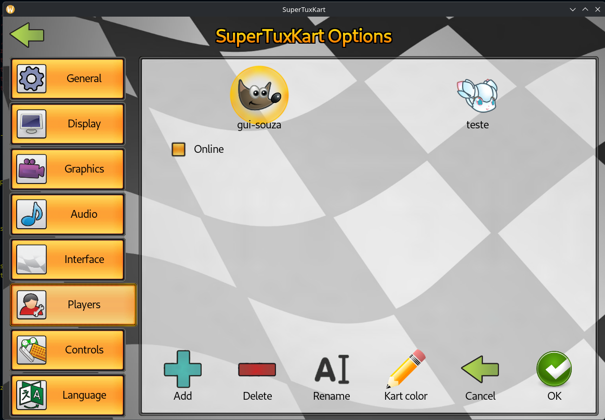
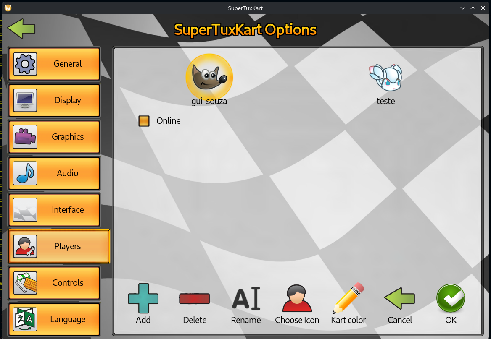
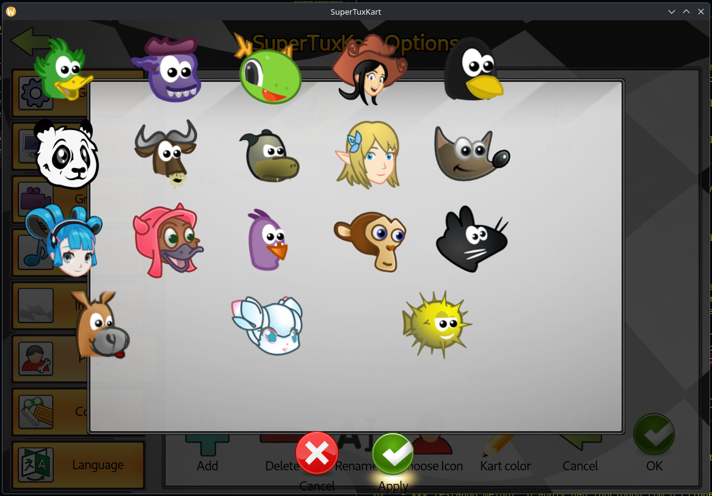

# Semana 10 - Postagem

Olá professor Daniel, tudo bem?
Iniciando meu registro da semana 10.

## Retorno inicial no Draft PR

No início da semana, recebi um retorno no [draft PR](https://github.com/supertuxkart/stk-code/pull/5907) que eu abri na semana 9, no qual havia ficado algumas pendências sobre GUI, onde o usuário me passou a [seguinte recomendação](https://github.com/supertuxkart/stk-code/pull/5907#issuecomment-6398405683):

> Take a look here: <br>
>   https://github.com/supertuxkart/stk-code/blob/master/data%2Fgui%2Fdialogs%2Fandroid%2Fmultitouch_settings.stkgui <br>
> This uses a ribbon widget (to show the control methods for mobile)

Mas sendo sincero, analisando o arquivo que ele me passou (`multitouch_settings.stkgui`), não achei o que poderia me ajudar pois são botões hardcoded em um ribbon estático (com elementos fixos em XML), e o que eu preciso é justamente um ribbon dinâmico (ribbon_grid), já que os ícones dos karts são povoados em tempo de execução.

Outra coisa que percebi também, é que nenhum dialog usa um ribbon_grid (tipo de ribbon dinâmico que estou tentando utilizar), sempre telas completas do tipo screen, por isso esta sendo dificil encontrar uma solução de fato.

Além disso, não queria propor um ajuste na engine para contornar os impedimentos do ribbon_grid antes de tentar alternativas ou sugestões do pessoal mais experiente na coisa, por isso, deixei a [seguinte resposta ao usuário](https://github.com/supertuxkart/stk-code/pull/5907#issuecomment-6418665828):

> @SewerFox Thanks for the pointer! I took a look at `multitouch_settings.stkgui`, but it uses a static `<ribbon>` with pre-defined buttons declared directly in XML. <br>
> In our case, since the kart icons must be loaded dynamically (and we have lots of icons, requiring multiple rows/scrolling), I had to use `<ribbon_grid>` (`DynamicRibbonWidget`). <br>
> Exploring the codebase, I noticed that `<ribbon_grid>` is currently only used in full screens (like `karts.stkgui` or `tracks.stkgui`), and never inside a Dialog. That seems to be the root of the issue, in my view:
>   1. In modal dialogs, mouse clicks on children of a ribbon widget seem to be ignored by the engine (`event_handler.cpp` filters out `WTYPE_RIBBON` parents in modals, so only keyboard Enter activates the item). <br>
>   2. The layout calculation in dialog causes the ribbon_grid to misalign or clip its upper border unless weird percentage paddings are hardcoded. <br>
>
> Do you guys know of any recommended way or existing pattern to dynamically display a list/grid of icons inside a dialog? I think it's better to stick to standard GUI practices rather than touching core engine behavior if possible. XD

## Choose Icon em outra tela

Enquanto aguardava um retorno sobre minha dúvida, explorando a codebase, descobri que a tela de user_screen era replicada dentro das configurações! Encontrei os códigos referentes a essa tela:
    - Classe -> `TabbedUserScreen`
    - XML -> `data/gui/screens/options/user_screen_tab.stkgui`

<p align="center">
    
</p>

O primeiro passo foi adicionar o botão no .stkgui da tela, assim como fiz na user_screen original:

```XML
<!-- ... -->
<buttonbar id="options" width="100%" height="100%" align="center">
    <icon-button
        id="new_user" width="128" height="128" icon="gui/icons/blue_plus.png" I18N="In the user screen" text="Add" label_location="bottom"
    />
    <icon-button
        id="delete" width="128" height="128" icon="gui/icons/remove.png" I18N="In the user screen" text="Delete" label_location="bottom"
    />
    <icon-button
        id="rename" width="128" height="128" icon="gui/icons/rename.png" I18N="In the user screen" text="Rename" label_location="bottom"
    />
    <!-- AQUI ! -->
    <icon-button
        id="choose_icon" width="128" height="128" icon="gui/icons/player.png" I18N="In the registration dialog"  text="Choose Icon" label_location="bottom"
    />
    <icon-button
        id="default_kart_color" width="128" height="128" icon="gui/icons/edit.png" I18N="In the user screen" text="Kart color" label_location="bottom"
    />
    <icon-button
        id="cancel" width="128" height="128" icon="gui/icons/back.png" I18N="In the user screen" text="Cancel" label_location="bottom"
    />
    <icon-button
        id="ok" width="128" height="128" icon="gui/icons/green_check.png" I18N="In the user screen" text="OK" label_location="bottom"
    />
</buttonbar>
<!-- ... -->
```

<p align="center">
    
</p>

Analisando a classe `TabbedUserScreen`, basicamente ela herda todo o comportamento da `BaseUserScreen` (classe que eu já estava trabalhando) usando callbacks. Ela basicamente tem uma tratativa especial ao renderizar pois é um pouco diferente, e os cliques, lida com interações no menu lateral, caso contrário, simplesmente repassa para o comportamento padrão da classe pai.

Portanto, ao clicar no `Choose Icon`, todo o comportamento que eu havia programado funciona igualzinho ao da outra tela! Em relação a isso, não precisei alterar mais nada!


<p align="center">
    
</p>

Porém sigo com os problemas de renderização e cliques, mas com o enter, funciona assim como na outra tela!

## Planejamento da segunda contribuição

Para não ficar parado, iniciei o planejamento da segunda contribuição, que seria permitir o upload de uma imagem para o usuário setar como icon.

- Requisitos básicos iniciais:
    - Delimitar tipo de arquivo permitido: png
    - Garantir que a imagem tenha uma proporção de 1:1 / quadrado (ou próximo disso)
    - Definir como inputar um arquivo no jogo
    - Adicionar o botão de upload lá no IconSelectionDialog

- Mapa mental básico inicial:
    1. Usuário inputar path do arquivo de ícone (provavelmente vou precisar de um outro modal p receber o arquivo)
    2. Checagem do arquivo, inicialmente, receber apenas png
    3. Substituir arquivo referente ao icone
        - ponteiro em ~/.config/supertuxkart/config-0.10/players.xml
    4. Atualizar user_screen

- Preciso fazer uso de:
    - file_manager para checar se o arquivo existe e cópia do mesmo
    - StringUtils para validar a extensão do arquivo
    - irr_driver para checagem do arquivo e proporção
