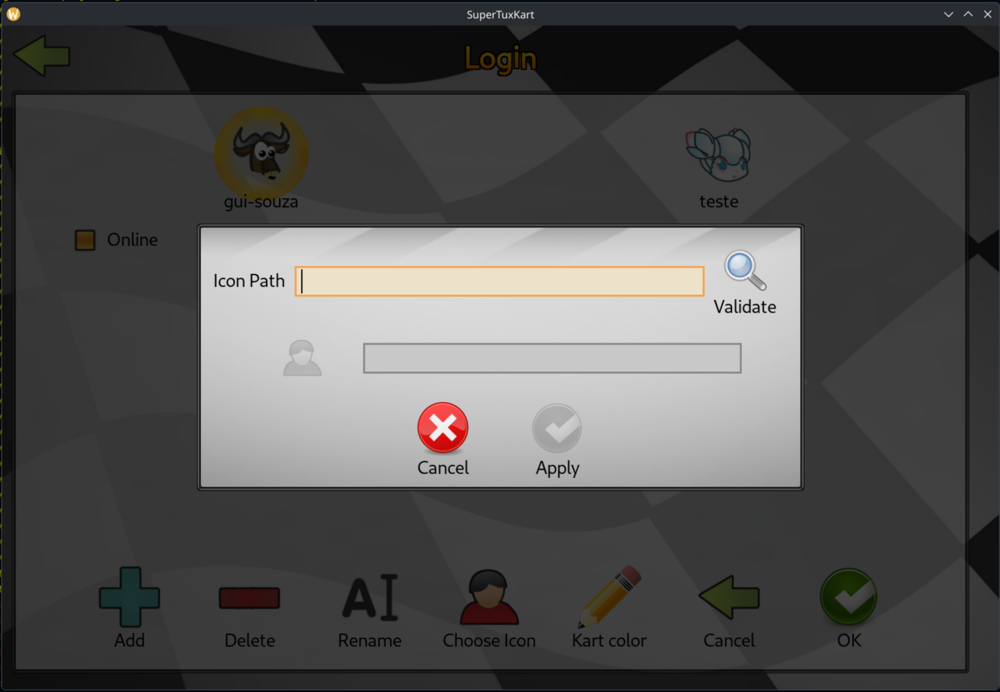
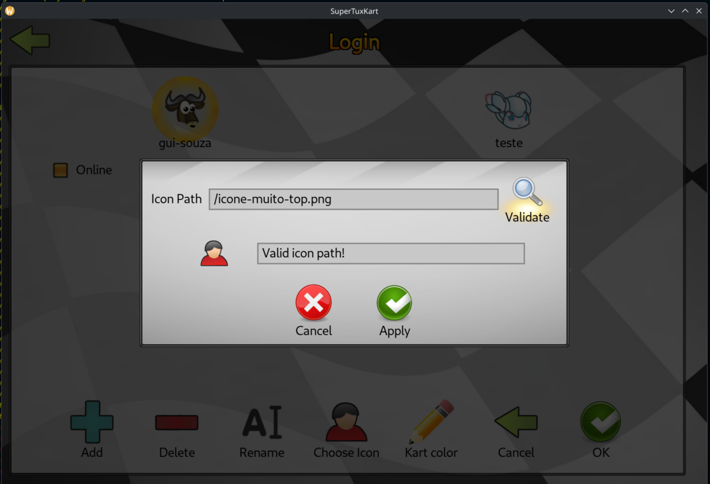

# Semana 11 - Postagem

Olá professor Daniel, tudo bem?
Iniciando meu registro da semana 11.

## Novo dialog: `IconPathInputDialog`

Durante essa semana, decidi dar um passo importante na segunda contribuição (permitir o upload/seleção de uma imagem customizada para o perfil) e criei um novo dialog dedicado para entrada e validação do caminho do arquivo: a classe `IconPathInputDialog`.

Como o SuperTuxKart roda em tela cheia e é multiplataforma, ele não possui um seletor de arquivos nativo do sistema operacional. Por isso, a abordagem pensada foi construir uma janela modal que recebe o caminho do arquivo, valida sua integridade/formato e dá um feedback visual ao jogador antes de confirmar a alteração.

Os passos que planejei para o funcionamento desse novo dialog foram:
1. Uma caixa de entrada de texto (`<textbox>`) para o usuário digitar/colar o caminho da imagem.
2. Um botão de validação (`Validate`).
3. Uma lógica de checagem: se o caminho e a imagem forem válidos, habilitar o botão de aplicação (`Apply`) e exibir uma prévia do ícone e mensagem de sucesso.
4. Caso o caminho seja inválido ou o arquivo ter algum erro, exibir uma mensagem ao usuário.
5. Caso ocorra cancelamento, fechar o dialog e retornar à tela do usuário sem alterar nada no perfil.

### Estrutura criada

O novo fluxo foi estruturado com arquivos dedicados:
- C++: `src/states_screens/dialogs/icon_path_input_dialog.hpp` e `.cpp`
- Layout XML: `data/gui/dialogs/icon_path_input_dialog.stkgui`

Além disso, liguei a abertura desse novo dialog direto pelo botão de upload que havia posicionado no dialog de seleção de ícones nativos (`IconSelectionDialog`):

```cpp
if (selection == "upload")
{
    new IconPathInputDialog(m_player_profile, m_parent_screen);
}
```

Ao abrir o novo modal sobre o anterior, a própria engine se encarrega de fechar a janela antiga e repassar os ponteiros necessários pelo contrutor do novo dialog (`PlayerProfile` e tela pai `BaseUserScreen`) para permitir a atualização do perfil e o recarregamento imediato do avatar na tela de usuários.

## Interface e Comportamento de UX

Brinquei bastante com a sintaxe do `.stkgui` para estruturar a interface com proporções e alinhamentos limpos. O diálogo conta com:
- O campo de texto para o caminho do arquivo junto ao botão de validação com ícone de busca.
- Uma área central de feedback com um placeholder para a prévia do ícone e uma caixa informativa de status.
- Uma barra inferior com botões de Cancelar e Aplicar.

Um detalhe importante de UX que implementei foi manter o botão de Apply inativo (`setActive(false)`) na inicialização, liberando-o apenas após a validação bem-sucedida do caminho.

<p align="center">
    
</p>

Quando o usuário valida um caminho correto, o diálogo exibe a mensagem afirmativa e libera o botão de confirmação:

<p align="center">
    
</p>

## Backend e Métodos Rascunhados

Com a estrutura de interface pronta e respondendo aos eventos, deixei rascunhadas as assinaturas e métodos que irão fechar a integração:
- `bool IconPathInputDialog::validatePath()`: responsável por checar a existência do arquivo no disco, verificar a extensão e inspecionar dimensões/proporções da imagem.
- `void IconPathInputDialog::renderNewIcon()`: para renderizar dinamicamente o preview do novo arquivo escolhido no diálogo.
- `void PlayerProfile::setIconFromPath(const std::string& icon_path)`: adicionado à classe `PlayerProfile` para realizar a cópia definitiva do arquivo customizado para a pasta de configuração local e invalidar o cache de texturas do avatar.

## Reflexões sobre o Processo e Aprendizados

Nessa semana consegui produzir bastante e avançar de forma 100% autônoma sem o uso de IA, me aprofundando diretamente na base de código do STK para entender os padrões de ciclo de vida dos diálogos (`beforeAddingWidgets`, `init`, `processEvent`), a manipulação de estados dos widgets (`setActive`, leitura de texto de `TextBoxWidget`) e o posicionamento de elementos via XML.

Foi um processo de bater bastante a cabeça: investigar como outras telas do jogo resolviam problemas parecidos, errar na inicialização dos widgets, ajustar e tentar de novo até as coisas finalmente encaixarem. Ver tudo funcionando no final, a validação liberando os botões na hora certa e a interface respondendo exatamente como planejado — deu uma sensação enorme de gratidão e confiança com a codebase e com o C++.

O único grande tradeoff desse ritmo foi o esforço de documentação: acabei entrando em um flow state de implementação e tive que fazer um registro retroativo de tudo o que foi construído, o que exige um tempinho extra para não deixar escapar detalhes do raciocínio.

## Próximos Passos

1. Validação e preview do arquivo
    - Implementar o miolo das checagens de arquivo em C++ (verificar existência via `FileManager`, conferir extensão `.png` e validar proporção 1:1) e renderizar dinamicamente a prévia da imagem no widget do diálogo antes da confirmação.

2. Refinamento visual da 1ª contribuição
    - Voltar ao `icon_selection_dialog.stkgui` e aplicar o que aprendi agora sobre o comportamento dos containers de diálogos para deixar o alinhamento do grid dos karts ainda mais limpo e padronizado.

3. Publicação oficial do PR #5907
    - Como já se passaram alguns dias sem retorno da comunidade e o código da primeira contribuição está maduro e funcional (seleção, persistência no perfil e atualização imediata de texturas funcionando via teclado), planejo tirar o PR do estado de Draft e marcá-lo como aberto oficialmente. Vou detalhar na descrição as pendências conhecidas de GUI (a questão do foco/clique do mouse no grid dentro de modais), pois acredito que colocar a contribuição na fila principal de revisão do repositório atrairá os mantenedores mais rápido para testarem e darem o feedback final.
