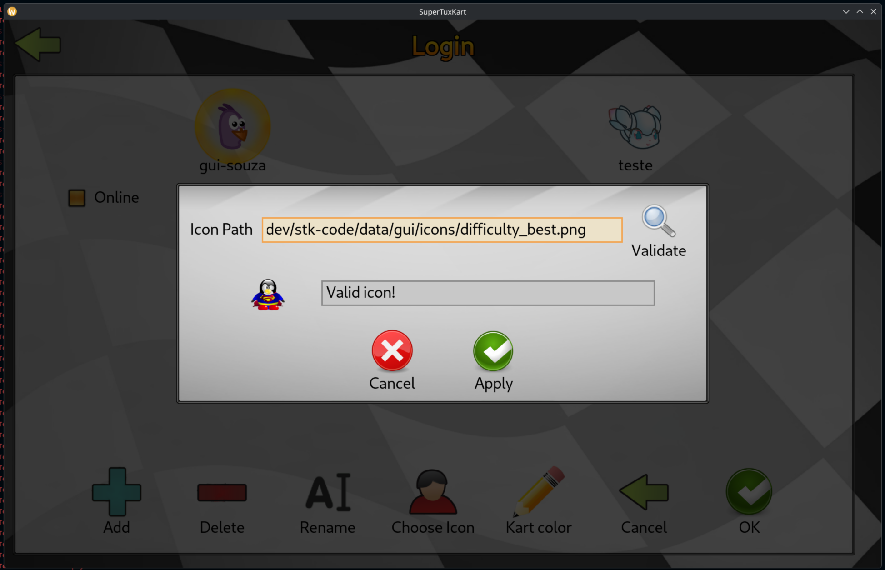
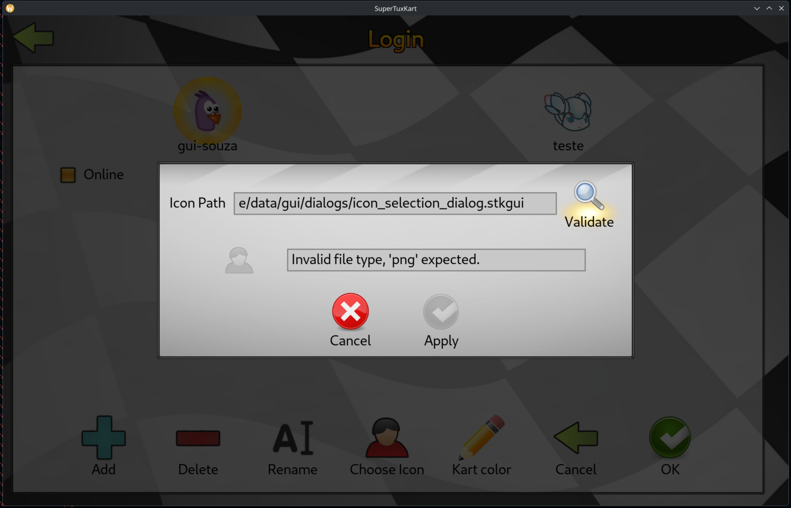

# Semana 12 - Postagem

Olá professor Daniel, tudo bem?
Iniciando meu registro da semana 12.

## Abertura oficial do PR #5907 (Ready for Review)

Para começar a semana, resolvi atacar a abertura oficial do primeiro Pull Request ([PR #5907](https://github.com/supertuxkart/stk-code/pull/5907)), referente à escolha de ícones nativos dos karts.

A minha ideia inicial era aplicar algumas melhorias de layout no `icon_selection_dialog.stkgui` com base no que aprendi ao construir o novo diálogo da segunda contribuição. No entanto, após revisar o código com calma, percebi que o alinhamento visual do grid já estava bem satisfatório e atendia ao propósito.

Dessa forma, como o fluxo principal está 100% funcional (seleção via teclado, salvamento da textura no perfil e recarregamento instantâneo do avatar na tela do usuário), decidi tirar o PR do estado de "Draft" e marcá-lo oficialmente como "Ready for Review", deixando o seguinte [comentário de contextualização](https://github.com/supertuxkart/stk-code/pull/5907#issuecomment-6809080619):

> Since the grid alignment is fixed, but still need some guidance on how to proceed, I'm sending this PR as ready for review, but also aware of what is still not ready on the Icon Selection Dialog:
> - Mouse selection: Hovering with the mouse highlights the item, but clicking doesn't trigger the selection action like pressing Enter on the keyboard does.
> - Arrow key navigation: Focus/arrow navigation across grid rows within the modal dialog doesn't work.
> ---
> Even though, it's possible now to choose an icon directly from the user_screen:
> - Click `Choose Icon`
> - On the dialog, hover the one you want and click enter (a check badge will appear)
> - Click `Apply`
> - Icon changed!

Com isso, os débitos técnicos conhecidos da engine em relação a diálogos modais ficaram claros e transparentes, colocando a contribuição na fila principal de revisão do repositório para que os mantenedores possam testar e opinar quando puderem.

## Validação de Arquivo e Prévia Dinâmica no `IconPathInputDialog`

Enquanto aguardo o retorno no primeiro PR, foquei totalmente na lógica da segunda contribuição, especificamente na implementação do método `IconPathInputDialog::validatePath()` e na renderização da prévia da imagem no diálogo.

### Escolha do Widget de Prévia

O primeiro passo foi definir o melhor widget para exibir o ícone escolhido após a validação. Analisando as documentações via Doxygen, encontrei a classe `IconButtonWidget`, que possui o método `setImage(...)` aceitando caminhos absolutos (`ICON_PATH_TYPE_ABSOLUTE`), se encaixou como uma luva para o propósito.

### Refatoração e Limpeza de Estado

Antes de iniciar a lógica de validação em si, fiz uma pequena limpeza no código. No diálogo, eu havia deixado duas variáveis com finalidades muito parecidas:
- `bool m_is_valid_icon_path`: flag que marcava se o caminho estava validado.
- `std::string m_icon_path`: o caminho do arquivo em si.

Seguindo o mesmo padrão elegante que o `PlayerProfile` adota na codebase, simplifiquei a lógica para depender apenas de `m_icon_path`:
- Se `m_icon_path.empty()`: caminho inválido.
- Se `!m_icon_path.empty()`: ícone válido pronto para ser aplicado.

Além disso, criei um método auxiliar `resetState()` para limpar o caminho e desativar o botão de confirmação (`m_apply_button->setActive(false)`) e o preview (`m_icon_render->setActive(false)`), garantindo que, caso o usuário digite um caminho inválido após um válido, o diálogo não fique em estado inconsistente.

### Implementação do `validatePath()`

A validação foi construída com foco em fail-fast, encadeando checagens progressivas e fornecendo feedback visual imediato para cada cenário de erro:

1. Input vazio - Verifica se o usuário não deixou o campo em branco.
2. Existência do arquivo no disco - Utiliza o singleton `file_manager->fileExists(path)` da engine.
3. Extensão do arquivo - Usa `StringUtils::getExtension(path)` e `StringUtils::toLowerCase(...)` para garantir formato `.png`.
4. Integridade da imagem - Através do driver de vídeo do Irrlicht (`irr_driver->getVideoDriver()->createImageFromFile(...)`), tenta decodificar a imagem na memória RAM. Se retornar null, identifica arquivo corrompido ou formato não suportado. Após ler as dimensões, chama imediatamente `img->drop()` para evitar memory leaks.
5. Proporção da imagem (Aspect Ratio) - Calcula a razão entre largura e altura (`width / height`). Adotei uma margem de tolerância aceitando razões entre `0.9` e `1.1`. Essa gordura de 10% é ótima para UX, pois valida imagens ligeiramente não quadradas (ex: 511x512 pixels) sem frustrar o usuário.

Apenas se o arquivo passar por todos esses filtros, o caminho válido é retornado para `m_icon_path`, o botão de Apply é liberado e a prévia do ícone é exibida!

### Suporte a Internacionalização (i18n)

Para manter o código alinhado às diretrizes de qualidade do SuperTuxKart, envolvi todas as mensagens de feedback ao usuário com a macro de internacionalização `_("...")` (fornecida por `#include "utils/translation.hpp"`). Com isso, as mensagens de erro e sucesso ficam prontas para serem extraídas pelo sistema de tradução do jogo (`tinygettext` / Weblate) para outros idiomas.

### Código Implementado

Dessa forma, visualmente esse foi o progresso feito:

<p align="center">
    
</p>
<p align="center">
    
</p>

O método de validação final ficou estruturado da seguinte forma:

```cpp
std::string IconPathInputDialog::validatePath()
{
    std::string path = StringUtils::wideToUtf8(
        getWidget<TextBoxWidget>("icon_path_textbox")->getText().c_str()
    );

    if (path.empty()) {
        m_icon_path_output_widget->setText(_("Please, provide an icon file path."));
        return "";
    }

    if (!file_manager->fileExists(path)) {
        m_icon_path_output_widget->setText(_("File does not exist."));
        return "";
    }

    if (StringUtils::toLowerCase(StringUtils::getExtension(path)) != "png") {
        m_icon_path_output_widget->setText(_("Invalid file type, 'png' expected."));
        return "";
    }

    video::IVideoDriver driver = irr_driver->getVideoDriver();
    video::IImage img = driver->createImageFromFile(path.c_str());
    if (!img) {
        m_icon_path_output_widget->setText(_("Unsupported or corrupted image."));
        return "";
    }
    core::dimension2d<u32> dim = img->getDimension();
    img->drop();

    float ratio = 0;
    if (dim.Width > 0 && dim.Height > 0) {
        ratio = (float) dim.Width / (float) dim.Height;
    }

    if (ratio < 0.9 || ratio > 1.1) {
        m_icon_path_output_widget->setText(_("Invalid image ratio, must be near 1:1."));
        return "";
    }

    return path;
}   // validatePath
```

E o processamento dos eventos no diálogo:

```cpp
GUIEngine::EventPropagation
            IconPathInputDialog::processEvent(const std::string& eventSource)
{
    if (eventSource == "path_input_buttons")
    {
        const std::string& selection = m_path_input_buttons_widget->
                                    getSelectionIDString(PLAYER_ID_GAME_MASTER);

        if (selection == "validate") {
            resetState();
            m_icon_path_output_widget->setText("");
            m_icon_path = validatePath();

            if (!m_icon_path.empty()) {
                m_icon_render->setImage(m_icon_path, IconButtonWidget::ICON_PATH_TYPE_ABSOLUTE);
                m_icon_render->setActive(true);
                m_icon_path_output_widget->setText(_("Valid icon!"));
                m_apply_button->setActive(true);
            }
            else
                resetState();
        }
    }

    if (eventSource == "buttons")
    {
        const std::string& selection = m_buttons_widget->
                                    getSelectionIDString(PLAYER_ID_GAME_MASTER);

        if (selection == "apply")
        {
            if (!m_icon_path.empty())
            {
                m_player_profile->setIconFromPath(m_icon_path);
                m_parent_screen->loadProfilesIcons();
            }

            ModalDialog::dismiss();
            return GUIEngine::EVENT_BLOCK;
        }
        else if (selection == "cancel")
        {
            ModalDialog::dismiss();
            return GUIEngine::EVENT_BLOCK;
        }
    }
    return GUIEngine::EVENT_LET;
}   // processEvent
```

## Próximos Passos

1. Refinamento visual do `IconPathInputDialog`: Ajustar detalhes de alinhamento e dimensões no XML da tela, especialmente o enquadramento do ícone de prévia após a validação.
2. Persistência no perfil: Implementar o método `PlayerProfile::setIconFromPath(const std::string& icon_path)` para copiar definitivamente o arquivo para a pasta de dados do usuário (`~/.config/supertuxkart/...`) e invalidar a textura anterior no cache.
3. Acompanhar o PR #5907: Ficar atento às respostas e comentários dos revisores agora que o primeiro PR está oficialmente aberto para revisão.
