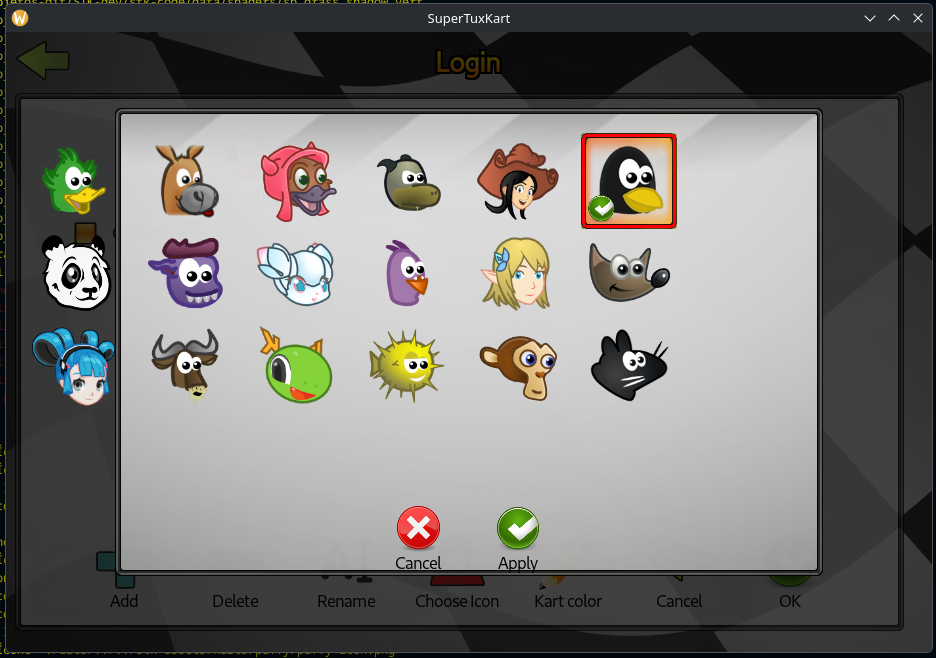

# Semana 8 - Postagem

Olá professor Daniel, tudo bem?
Iniciando meu registro da semana 8.

### Novo fluxo de trabalho

Dando seguimento no projeto, acabei ficando um pouco frustado com vai e vem que acabou acontecendo na semana 7. Antes de voltar pro código, dei uma pausa e re-pensada no meu fluxo que estava usando para desenvolver minha contribuição no projeto, e notei alguns pontos importantes:

1. Uso/dependência excessiva de IA para análise do código: definitivamente não estava usando IA para escrever meu código, mas sim para analisar e me ajudar a encontrar referências e direcionamento no meio da extensa codebase, mas acho que isso acabou mais me confundindo e gerando uma certa dependência do que ajudando. O uso excessivo se deu imagino pelo medo de um grande codebase, já que é minha primeira vez lidando com algo do tipo; vou elaborar mais à frente na postagem, mas colocar a cara a tapa contra o código e o medo dele sem auxílio de IA acabou gerando mais frutos e produtividade.

2. Falta de uma documentação/guia: Além do medo de uma grande codebase, estava me sentindo muito perdido pois estava sentindo uma dificuldade de entender nos componentes d código o que usa o que, o porquê de algumas coisas e algumas entrelinhas, msmo o código estando bem documentado, confiar nos snippets de documentação da IDE não estava sendo o melhor caminho, então explorando um pouco a codebase no sentido de tentar achar algum direcionamento melhor de documentação / enciclopédia do repositório, descobri que há o uso da convenção e configuração da ferramenta Doxygen!

### Doxygen

Em algum outro projeto no passado, tive contato com a ferramenta, por isso a identifiquei. Basicamente, é uma ferramenta que busca facilitar uma autodocumentação do código, de forma que, ao adicionar comentários com uma sintaxe específica e rodar a ferramenta em cima do código, seja gerado uma "enciclopédia" em HTML do código!
Pro meu caso, que estou tentando descobrir como os widgets e GUI funcionam, ou o que são componentes em específico, ajuda demais.

### Retomada do projeto sem IA

Como falei no início, devido a alguns entraves que identifiquei que estavam mais me atrasando do que ajudando, decidi retomar o ponto estável no qual eu havia alcançado na semana passada/retrasada antes da mudança de rota que fiz ao fim da semana 7.

Retornei meu código para o ponto em que os ícones dos personagens fossem gerados dinamicamente no dialog, mesmo que descentralizados e sem o clique / nagevação funcionando como esperado. Portanto, insisti no dynamic ribbon widget, mas junto da documentação recém "descoberta"

Fiz isso com o intuito de tentar seguir com o que eu tinha em mãos, ao menos tentar chegar num ponto no qual fosse possível escolher um ícone, mesmo que de forma pouco ergonômica.

### Finalização mínima no Dialog

Para conseguir arrumar a "fiação" que liga a GUI com o processamento real da persistência do ícone, precisei finalizar algumas coisas no Dialog. Já estava pronto e funcional a renderização dinâmica dos ícones. Além disso, implementei:

- Um marcador de check no ícone selecionado

    ```cpp
    if (eventSource == "kart_icons")
    {
        m_selected_kart = m_kart_icons_widget->getSelectionIDString(PLAYER_ID_GAME_MASTER);
        if (!m_selected_kart.empty())
        {
            m_kart_icons_widget->setBadge(m_selected_kart, GUIEngine::OK_BADGE);
            m_kart_icons_widget->updateItemDisplay();
        }
    }
    ```

<p align="center">
    
</p>

- Na finalização de caminho feliz do dialog, ou seja, no apply, a chamada da função de persistência no profile:

    ```cpp
    if (selection == "apply")
    {
        if (!m_selected_kart.empty())
        {
            m_player_profile->setIconFromKart(m_selected_kart);
            m_player_manager->get()->initRemainingData();
        }

        ModalDialog::dismiss();
        return GUIEngine::EVENT_BLOCK;
    }
    ```

### Implementação de PlayerProfile::setIconFromKart

Como já planejado anteriormente, ao escolher um ícone na tela do dialog, seria chamada a função que persiste o ícone selecionado no profile do player ativo, a qual nomeei PlayerProfile::setIconFromKart.
Relembrando um pouco de um contexto anterior relacionado a icons no PlayerProfile, já existia uma função chamada PlayerProfile::addIcon, mas o usuário não tinha acesso a ela, basicamente, apenas validava se o icone relacionado a conta estava ok, e se a conta ainda não tivesse um ícone, escolher um de forma pseudo-aleatória.

Com isso em mente, pensando em aproveitar o que já existe em addIcon, fiz o seguinte:

- Novo campo std::string m_icon_kart_ident no PlayerProfile

    1. Usuário escolhe o ícone no Dialog
    2. Pelo dialog, é chamado setIconFromKart, passando o identificador do ícone escolhido, e salvando no campo criado m_icon_kart_ident, além disso, para que addIcon seja devidamente acionado, preciso "zerar" o campo m_icon_filename, ou seja, zerar a referência de um icon anterior, a então o addIcon aja atualizando com o novo ícone selecionado

    ```cpp
    void PlayerProfile::setIconFromKart(const std::string& kart_ident)
    {

        m_icon_kart_ident = kart_ident;
        m_icon_filename = "";
        addIcon();
    } 
    ```

    3. Dessa forma, agora o caminho pavimentado, precisei atualizar a condição de seleção do kart no próprio addIcon

    ```cpp
    void PlayerProfile::addIcon()
    {
        if (m_icon_filename.size() > 0 || isGuestAccount())
            return;

        // Aqui está minha alteração, adicionei a condição de checagem de tamanho
        // do m_icon_kart_ident, ou seja, se houver algum icon selecionado,
        // buscamos o id do kart, para que possamos buscar o path do icon do mesmo
        int kart_id;
        if (m_icon_kart_ident.size() > 0)
            kart_id = kart_properties_manager->getKartId(m_icon_kart_ident);
        // Mantive aqui a seleção pseudo-aleatória previamente existente
        else
            kart_id = (m_unique_id + kart_properties_manager->getKartId("tux") - 1)
                % kart_properties_manager->getNumberOfKarts();

        std::string source = kart_properties_manager->getKartById(kart_id)
                                                    ->getAbsoluteIconFile();

        std::ostringstream out;
        out << m_unique_id <<"."<<StringUtils::getExtension(source);
        if(file_manager->copyFile(source,
                                file_manager->getUserConfigFile(out.str())) )
        {
            m_icon_filename = out.str();
        }
        else
        {
            m_icon_filename = "";
        }
    } 
    ```

E essa implementação funciona perfeitamente! Ao abrir o diretório de configs do jogo, é possível ver o ícone do respectivo profile mudando em tempo real! Porém, na tela do jogo, só é possível ver o novo ícone selecionado ao fechar e abrir, isso ocorre pois o xml na tela de profiles, o trigger de atualizar a tela com os ícones dos players só ocorre ao abrir o jogo.

Os próximos passos vão ser focados nisso, além de tentar ajustar os problemas do dialog já conhecidos:
<br>- Centralizar o grid dentro do modal
<br>- Clique com mouse, apenas o enter está funcionando
<br>- Navegação com as setinhas
